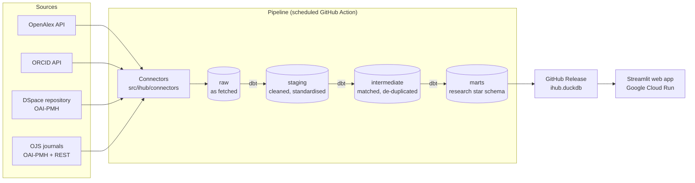

# iHub Data Analytics Platform

A prototype analytics platform for Zambian universities, using the **University of Zambia (UNZA)** as the case study.

**Iteration 1** covers research information only. It is aggregated from:

| Source | Access method |
|---|---|
| OpenAlex | REST API |
| ORCID | Public API (v3.0) |
| UNZA Institutional Repository (DSpace) | OAI-PMH |
| UNZA journals on OJS (15 journals) | OAI-PMH and the OJS REST API |

Google Scholar is out of scope because it has no official API. Later iterations will add other university systems (student information, LMS, HR/payroll, staff performance, promotions), so every source is a self-contained connector.

## Architecture



- **Connectors** (Python) fetch data and store it unchanged in the `raw` schema.
- **dbt** models clean it (`staging`), match and de-duplicate across sources (`intermediate`), then build the research star schema (`marts`).
- The pipeline publishes the resulting DuckDB file as a GitHub Release asset. The web app image includes that file and runs on Cloud Run.

Design decisions are recorded in [`docs/decisions/`](docs/decisions/).

## Repository layout

```
config/sources.yml        non-secret connector settings
src/ihub/connectors/      one module per source (shared interface in base.py)
src/ihub/ingest/          runs connectors, loads raw data into DuckDB
src/ihub/mart/            read-only query functions used by the app
src/ihub/app/             Streamlit app (Home.py + pages/)
transform/                dbt project: staging, intermediate, marts, seeds
tests/                    pytest tests
docs/decisions/           architecture decision records (ADRs)
data/                     local data and DuckDB file (git-ignored)
```

## Setup

Requirements: [uv](https://docs.astral.sh/uv/) and Git. uv installs Python 3.12 for you.

```bash
# 1. Clone
git clone https://github.com/DataLab-UNZA/ihub-data-analytics-platform.git
cd ihub-data-analytics-platform

# 2. Create the environment and install everything (app + dev tools + dbt)
uv sync --all-groups

# 3. Local settings (never commit .env)
cp .env.example .env        # then fill in the values you have

# 4. Enable the pre-commit hooks (ruff, secret check)
uv run pre-commit install
```

## Run

```bash
# Lint and format check
uv run ruff check .
uv run ruff format --check .

# Tests
uv run pytest

# Web app (opens at http://localhost:8501)
uv run streamlit run src/ihub/app/Home.py

# Pipeline (no connectors yet: creates data/ihub.duckdb and records the run)
uv run python -m ihub.ingest
```

## Deployment

The app is live at **https://ihub-app-197899767407.africa-south1.run.app** (Google Cloud Run, Johannesburg). Every merge to `main` deploys automatically once a member of the `ihub-deployers` team approves it in GitHub Actions, and a weekly pipeline refreshes the data. See [`docs/DEPLOYMENT.md`](docs/DEPLOYMENT.md) for how it works, how to roll back and how to check costs.

## Contributing

- `main` is protected: all changes go through a pull request, and CI (lint + tests) must pass.
- Work in mob sessions follows the rules in [`CLAUDE.md`](CLAUDE.md), including the prompt log and commit-message format.
- Never commit secrets. Put API keys in `.env` locally and in the GitHub `pipeline` environment for Actions. Every variable name is listed in `.env.example`.
