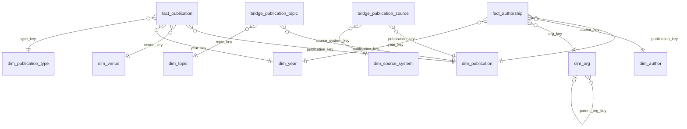

# Data dictionary: the research mart

This describes every table and column of the research star schema: the `marts` schema in `data/ihub.duckdb`, built by dbt from `transform/models/marts/research/`. Read it before you query the mart or add a page. The design behind it is in [`CLAUDE.md`](../CLAUDE.md), [ADR-003](decisions/ADR-003-staging-and-department-attribution.md) and [ADR-004](decisions/ADR-004-research-mart-organisations-and-authorships.md).

Column names and types are exactly as dbt builds them. `tests/test_data_dictionary.py` builds the mart and fails if this file and the mart disagree, so update this file in the same pull request as the model. A column that is designed but not built yet is marked **planned**; there are none at the moment.

The row counts are from the first full build on real data, on November 12, 2026, and change with every data refresh.

## How the tables fit together



## Rules for querying correctly

- **A publication is de-duplicated.** One row of `fact_publication` can stand for several source records: an OpenAlex work, a repository item and an ORCID work with the same DOI, for example. `bridge_publication_source` lists them.
- **Count authors with `count(distinct author_key)`.** An author with two affiliations on one publication has two rows in `fact_authorship`.
- **Leave out the placeholder rows** when you list people or organisations. These are the author "No author listed" (`author_key = md5('author:none')`, which gives each publication at least one row at UNZA) and the organisation "Unknown organisation" (`org_kind = 'unknown'`).
- **NULL means unknown, not zero.** `n_unza_authors` and `is_international_collab` are NULL when OpenAlex gives no affiliation for the publication (13,846 of 24,472 publications). Show them as unknown; never count NULL as 0 or false.
- **Open-access data comes from OpenAlex only.** For a publication that is not in OpenAlex, `is_oa` is false and `oa_status` is `unknown`. Read that pair as "not known", not as "closed".
- **Citations come from OpenAlex only.** `cited_by_count` is 0 for publications that are not in OpenAlex.
- **To filter by source, use `bridge_publication_source`.** `fact_publication` has flags for OpenAlex, the repository and OJS, but not for ORCID.
- **The global year filter** is a condition on `year_key` in the fact tables. Every publication has a year: a publication that no source dates is left out of the mart (220 on November 12, 2026, almost all of them ORCID works entered without a date).
- **Past examination papers held in the repository are still counted as publications** until the exclusion deferred in ADR-004 (decision 11) is done.
- **Keys are text hashes** (`md5` of a stable identifier). Join on them; do not show them or rely on their values.

## Fact tables

### `fact_publication`

**Grain:** one row per de-duplicated publication that at least one source dates. 24,472 rows.

| Column | Type | Role | Description |
|---|---|---|---|
| `publication_key` | VARCHAR | key → `dim_publication` | The de-duplicated publication. |
| `venue_key` | VARCHAR | key → `dim_venue` | Where it was published; the "Unknown venue" row when no source names one. |
| `year_key` | INTEGER | key → `dim_year` | Publication year, from the highest-priority source that gives one (OpenAlex, then the repository, OJS, ORCID). |
| `type_key` | VARCHAR | key → `dim_publication_type` | Publication type; "unknown" when no source gives one. |
| `cited_by_count` | INTEGER | measure | Citations recorded by OpenAlex (the highest count among the publication's OpenAlex records). 0 when the publication is not in OpenAlex. |
| `n_authors` | HUGEINT | measure | Authors listed, the highest count among the publication's records. OpenAlex lists at most 100; ORCID works count 0. |
| `n_unza_authors` | BIGINT | measure | Distinct authors whose OpenAlex affiliation is UNZA. NULL when OpenAlex gives no affiliation. Understates UNZA's authors, because ORCID, repository and OJS evidence is not counted (ADR-004). |
| `is_oa` | BOOLEAN | measure | True when any source says the publication is open access. Only OpenAlex gives this, so false outside OpenAlex means unknown. |
| `oa_status` | VARCHAR | attribute | OpenAlex open-access status: `gold`, `green`, `hybrid`, `bronze`, `diamond`, `closed`, or `unknown` when no source gives one. |
| `is_international_collab` | BOOLEAN | measure | True when any OpenAlex affiliation on the publication is outside Zambia. NULL when OpenAlex gives no affiliation. |
| `in_openalex` | BOOLEAN | flag | At least one record came from OpenAlex. |
| `in_repository` | BOOLEAN | flag | At least one record came from the UNZA Institutional Repository (IRIMS). |
| `in_ojs` | BOOLEAN | flag | At least one record came from UNZA's OJS journals. |

### `fact_authorship`

**Grain:** one row per publication × author × organisation. 118,878 rows.

| Column | Type | Role | Description |
|---|---|---|---|
| `publication_key` | VARCHAR | key → `dim_publication` | The publication. |
| `author_key` | VARCHAR | key → `dim_author` | The author; `md5('author:none')` is the "No author listed" placeholder. |
| `org_key` | VARCHAR | key → `dim_org` | The organisation the author is credited to on this publication. |
| `year_key` | INTEGER | key → `dim_year` | The publication's year, as in `fact_publication`. |
| `author_position` | BIGINT | attribute | 1 for the first author, 2 for the second, and so on. NULL on placeholder rows. |
| `is_corresponding` | BOOLEAN | attribute | True when OpenAlex marks the author as corresponding author. |
| `org_basis` | VARCHAR | attribute | The rule that produced the row: `openalex_institution` (an institution other than UNZA, from OpenAlex), `author_department` (a UNZA department found for this author: OpenAlex affiliation text or an ORCID employment), `publication_department` (the department found for the publication, from repository collections), `unassigned` ("Unassigned department") or `unknown_organisation`. |

Authorships come from OpenAlex, plus the name-only authors from the repository and OJS for publications that are not in OpenAlex. A person who appears only in the repository or OJS can appear as more than one author.

## Dimension tables

### `dim_publication`

**Grain:** one row per de-duplicated publication. 24,472 rows.

| Column | Type | Role | Description |
|---|---|---|---|
| `publication_key` | VARCHAR | key | The publication. |
| `title` | VARCHAR | attribute | Title from the highest-priority source that has one; "Untitled" when none has. |
| `doi` | VARCHAR | attribute | DOI in lower case without the `https://doi.org/` prefix, e.g. `10.1016/s0140-6736(16)31392-7`. NULL when no source gives one. |
| `doi_url` | VARCHAR | attribute | The DOI as a link. NULL without a DOI. |
| `primary_source_system` | VARCHAR | attribute | The source that supplied the descriptive fields: `openalex`, `dspace_oai`, `ojs` or `orcid`. |
| `primary_record_url` | VARCHAR | attribute | The publication's record in that source (OpenAlex work, repository item, OJS article or ORCID work link). Can be NULL for ORCID works. |

### `dim_author`

**Grain:** one row per de-duplicated author, plus the "No author listed" row. 42,328 rows. Authors match on ORCID iD first, then OpenAlex author ID; name-only repository and OJS authors are not matched.

| Column | Type | Role | Description |
|---|---|---|---|
| `author_key` | VARCHAR | key | The author. |
| `author_name` | VARCHAR | attribute | Name from the highest-priority source; "Unknown author" when no source gives one, "No author listed" for the placeholder. |
| `orcid_id` | VARCHAR | attribute | ORCID iD, e.g. `0000-0003-3582-9866`. |
| `orcid_url` | VARCHAR | attribute | The ORCID iD as a link. |
| `openalex_author_id` | VARCHAR | attribute | OpenAlex author ID, e.g. `A5044179628`. |
| `openalex_url` | VARCHAR | attribute | The OpenAlex author as a link. |
| `is_unza_author` | BOOLEAN | attribute | True for an author with an OpenAlex authorship that names UNZA, or a UNZA employment on their ORCID record. Use it to list UNZA's researchers. |
| `n_source_records` | BIGINT | measure | Author records from all sources behind this author. |
| `n_sources` | BIGINT | measure | Number of different sources those records came from. |

### `dim_org`

**Grain:** one row per organisation. 4,823 rows, of three kinds (`org_kind`).

| Column | Type | Role | Description |
|---|---|---|---|
| `org_key` | VARCHAR | key | The organisation. |
| `org_id` | VARCHAR | attribute | `unza/...` for UNZA units (from the `unza_org_units` seed, e.g. `unza/education/library-and-information-science`), `openalex:<ID>` for other institutions, `unassigned-department`, or `unknown-organisation`. |
| `org_name` | VARCHAR | attribute | The organisation's name. |
| `org_kind` | VARCHAR | attribute | `unza_unit` (UNZA and its units, including "Unassigned department"), `external` (another institution named by OpenAlex) or `unknown` ("Unknown organisation"). |
| `org_type` | VARCHAR | attribute | For UNZA units: `institution`, `school`, `department`, `centre`, `library`, `institute`, `directorate` or `unassigned`. For external institutions, OpenAlex's type: `education`, `healthcare`, `facility`, `government`, `nonprofit`, `company`, `funder`, `archive` or `other`. `unknown` for the unknown row. |
| `parent_org_key` | VARCHAR | key → `dim_org` | The unit one level up (department → school → UNZA). Only UNZA units have one. |
| `school_name` | VARCHAR | attribute | The school a UNZA unit belongs to (its own name for a school). NULL for units outside the schools and for external institutions. |
| `country_code` | VARCHAR | attribute | Two-letter country code: `ZM` for UNZA units, OpenAlex's code for external institutions. NULL when unknown. |
| `ror` | VARCHAR | attribute | ROR identifier of an external institution, as a link. |

### `dim_venue`

**Grain:** one row per venue, plus one "Unknown venue" row. 2,723 rows.

| Column | Type | Role | Description |
|---|---|---|---|
| `venue_key` | VARCHAR | key | The venue. |
| `venue_id` | VARCHAR | attribute | OpenAlex source ID (e.g. `S49861241`), or `ojs:` plus the journal's path for UNZA's OJS journals (e.g. `ojs:JABS`). NULL for "Unknown venue". |
| `venue_name` | VARCHAR | attribute | Journal, repository or conference name. An OJS journal whose citations do not name it is shown as "OJS journal <path>". |

### `dim_year`

**Grain:** one row per calendar year from the earliest to the latest publication year, with no gaps, so charts show years without publications as zero. 67 rows (1961 to 2027).

| Column | Type | Role | Description |
|---|---|---|---|
| `year_key` | BIGINT | key | The year; joins `year_key` in the fact tables. |
| `year` | BIGINT | attribute | The year. |
| `decade_start` | INTEGER | attribute | First year of the decade, e.g. 2010. |
| `decade_label` | VARCHAR | attribute | The decade as text, e.g. `2010s`. |

### `dim_publication_type`

**Grain:** one row per publication type in use. 24 rows.

| Column | Type | Role | Description |
|---|---|---|---|
| `type_key` | VARCHAR | key | The type. |
| `type_code` | VARCHAR | attribute | The type in the OpenAlex vocabulary, e.g. `article`, `book-chapter`, `dissertation`, `preprint`; `unknown` when no source gives one. Repository, OJS and ORCID types are mapped onto it in staging. |
| `type_label` | VARCHAR | attribute | The code for display, e.g. "Book chapter". |

### `dim_topic`

**Grain:** one row per OpenAlex topic. 2,621 rows. Topics come from OpenAlex only.

| Column | Type | Role | Description |
|---|---|---|---|
| `topic_key` | VARCHAR | key | The topic. |
| `topic_id` | VARCHAR | attribute | OpenAlex topic ID, e.g. `T10556`. |
| `topic_name` | VARCHAR | attribute | Topic name. |
| `subfield_id` | VARCHAR | attribute | OpenAlex subfield ID. |
| `subfield_name` | VARCHAR | attribute | Subfield name. |
| `field_id` | VARCHAR | attribute | OpenAlex field ID. |
| `field_name` | VARCHAR | attribute | Field name. |
| `domain_id` | VARCHAR | attribute | OpenAlex domain ID. |
| `domain_name` | VARCHAR | attribute | Domain name (the top of OpenAlex's hierarchy: domain > field > subfield > topic). |

### `dim_source_system`

**Grain:** one row per source the platform reads publications from. 4 rows, from the `source_systems` seed.

| Column | Type | Role | Description |
|---|---|---|---|
| `source_system_key` | VARCHAR | key | The source. |
| `source_system` | VARCHAR | attribute | Short name, as in the raw and intermediate layers: `openalex`, `orcid`, `dspace_oai` (the repository) or `ojs`. |
| `source_name` | VARCHAR | attribute | Name shown in the app, e.g. "UNZA Institutional Repository (IRIMS)". |
| `source_kind` | VARCHAR | attribute | What kind of source it is, e.g. "bibliographic index". |
| `description` | VARCHAR | attribute | What the platform takes from it. |

## Bridge tables

### `bridge_publication_source`

**Grain:** one row per source record, linked to its de-duplicated publication. 28,350 rows. The way to find which sources hold a publication, and what the Source coverage page counts.

| Column | Type | Role | Description |
|---|---|---|---|
| `publication_key` | VARCHAR | key → `dim_publication` | The publication the record belongs to. |
| `source_system_key` | VARCHAR | key → `dim_source_system` | The source the record came from. |
| `source_record_id` | VARCHAR | attribute | The record's ID in its source: OpenAlex work ID, repository OAI identifier, OJS OAI identifier, or `<ORCID iD>:<put-code>` for an ORCID work. |
| `source_url` | VARCHAR | attribute | The record's page in its source. Repository links point to `https://rims.unza.ac.zm/handle/...`. |
| `match_rule` | VARCHAR | attribute | How the record was matched to the publication: `doi`, `title_year_to_doi` (no DOI, but its title and year point to exactly one DOI), `title_year` (title, year and first-author surname) or `single_record`. |

### `bridge_publication_topic`

**Grain:** one row per publication × OpenAlex topic. 31,836 rows. Publications OpenAlex gives no topics have no rows.

| Column | Type | Role | Description |
|---|---|---|---|
| `publication_key` | VARCHAR | key → `dim_publication` | The publication. |
| `topic_key` | VARCHAR | key → `dim_topic` | The topic. |
| `score` | DOUBLE | measure | How well OpenAlex thinks the topic fits, from 0 to 1 (the best score among the publication's OpenAlex records). |
| `is_primary_topic` | BOOLEAN | attribute | True when OpenAlex names this as the publication's primary topic. |

## Example queries

Publications per year with their open-access share, over the years of the global filter:

```sql
select year_key as year, count(*) as publications,
       count(*) filter (where is_oa) as open_access
from marts.fact_publication
where year_key between 2015 and 2025
group by 1
order by 1;
```

UNZA researchers per school (placeholder rows left out):

```sql
select o.school_name, count(distinct a.author_key) as researchers
from marts.fact_authorship as fa
join marts.dim_author as a using (author_key)
join marts.dim_org as o using (org_key)
where o.org_kind = 'unza_unit' and a.is_unza_author and o.school_name is not null
group by 1
order by 2 desc;
```

Publications in OpenAlex but not in the repository:

```sql
select count(*)
from marts.fact_publication as f
where f.publication_key in (
        select b.publication_key from marts.bridge_publication_source as b
        join marts.dim_source_system as s using (source_system_key)
        where s.source_system = 'openalex')
  and f.publication_key not in (
        select b.publication_key from marts.bridge_publication_source as b
        join marts.dim_source_system as s using (source_system_key)
        where s.source_system = 'dspace_oai');
```
